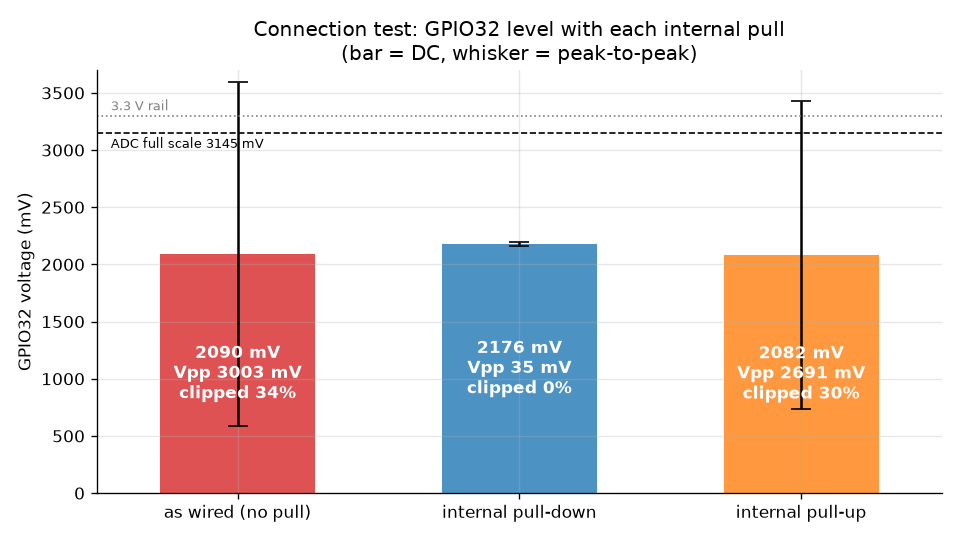
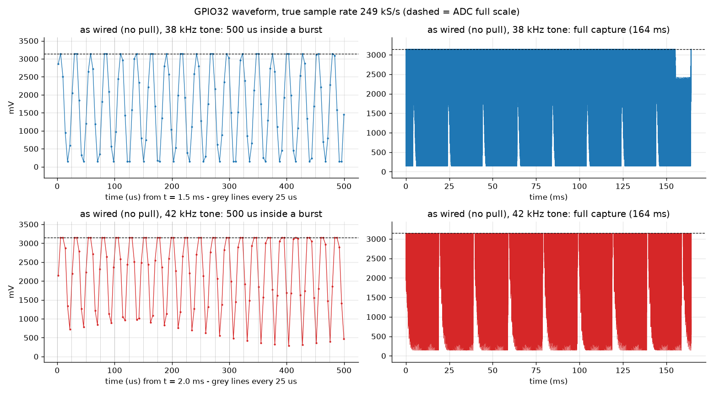
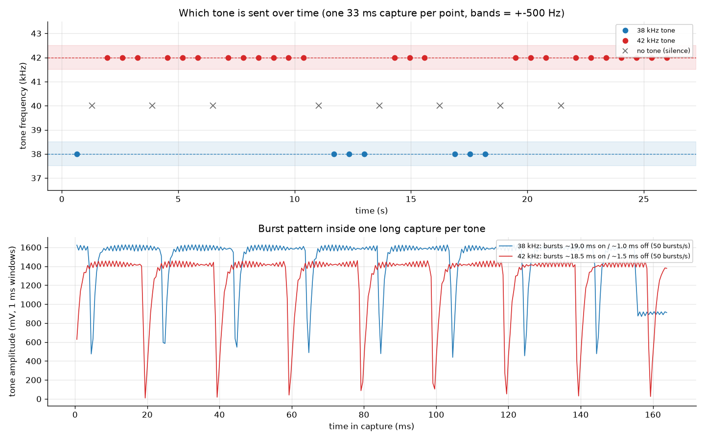
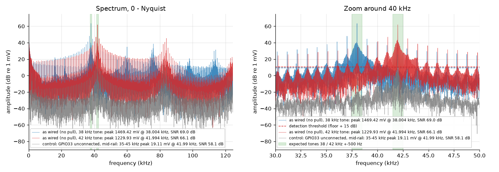
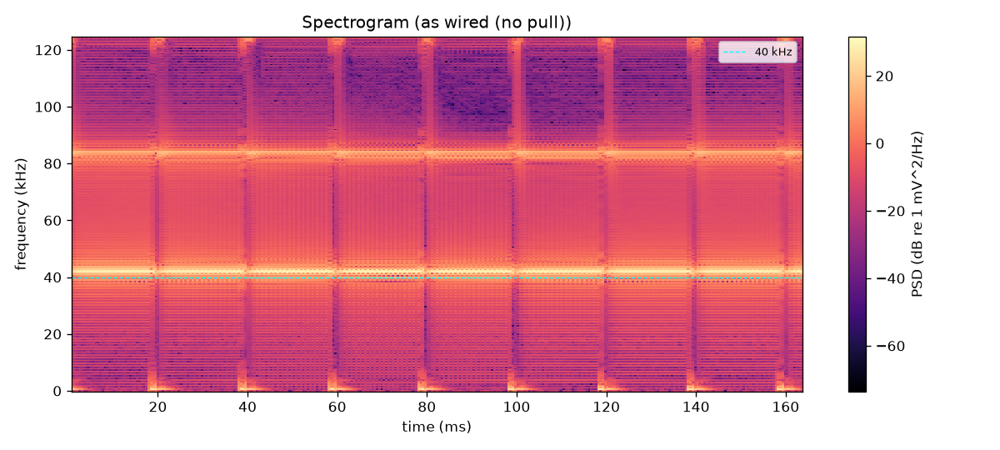
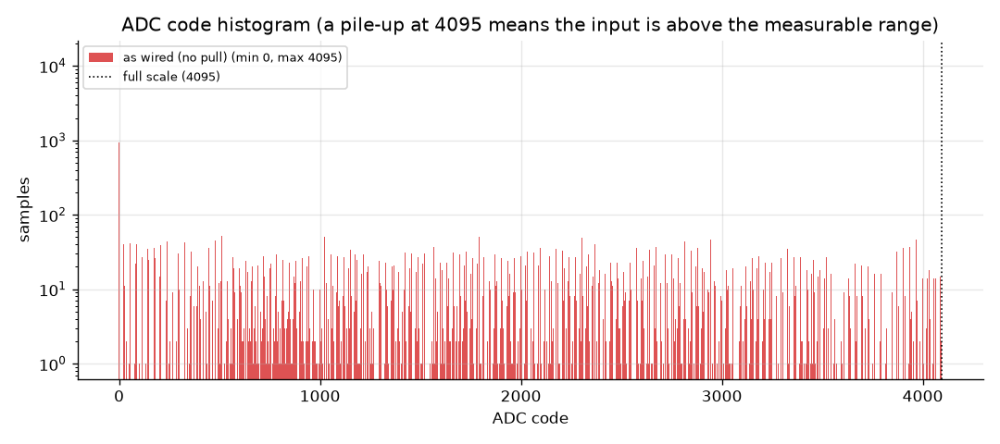
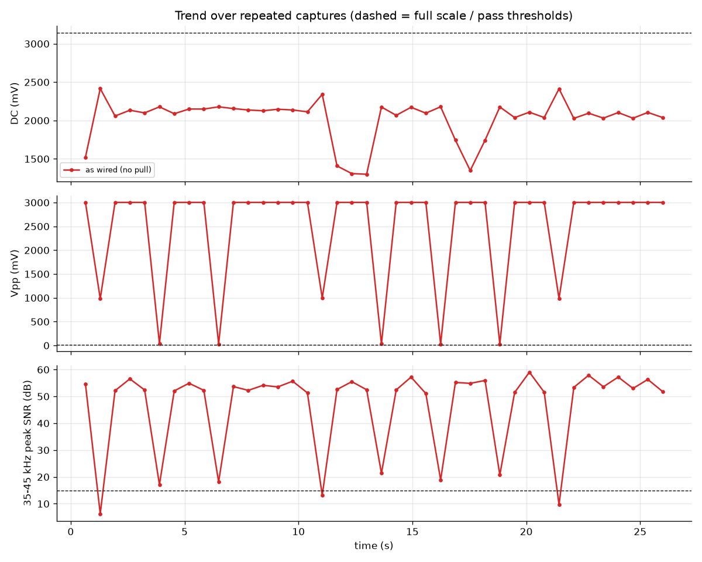
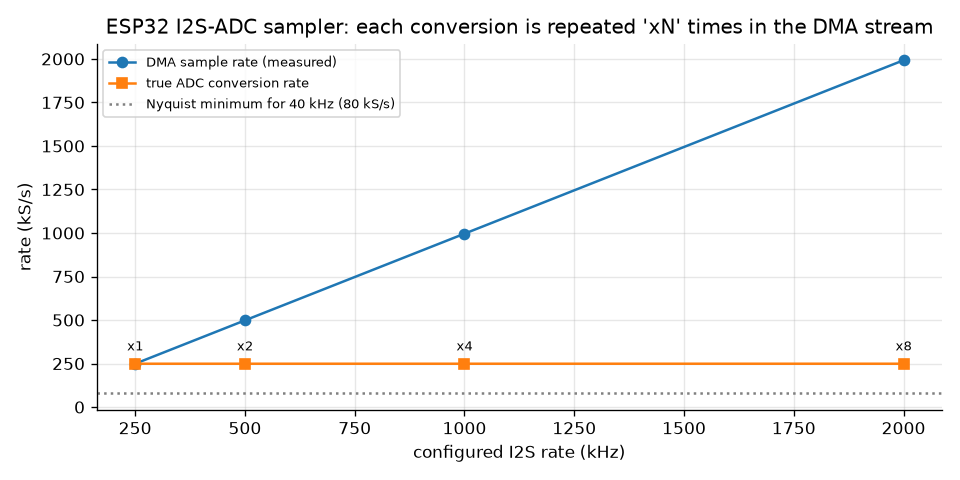
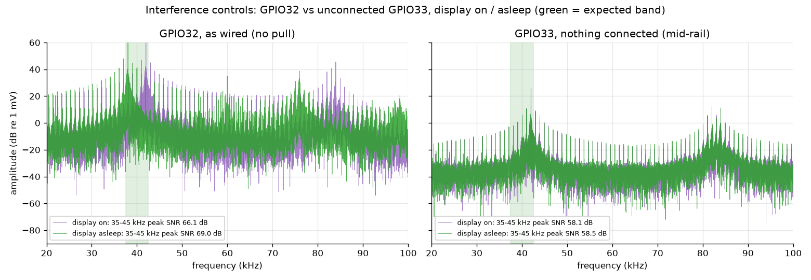

# GPIO32 ultrasonic signal check

- **Date:** 2026-10-02T17:02:35
- **Board:** LilyGO T-Display v1.1 (ESP32-D0WDQ6-V3), firmware `ultrasonic_probe`
- **Input:** GPIO32 = ADC1 channel 4, 12 dB attenuation (range ~142-3145 mV, eFuse-calibrated)
- **Sampler:** I2S built-in ADC DMA, configured 250 kHz, true conversion rate **249.0 kS/s** (6.2 samples per 40 kHz period)

## Verdict: PASS with warnings - both FSK tones present

- **Warning:** 30% of samples sit at an ADC limit (24% at the top (3145 mV), 5% at the bottom (142 mV)); inside the bursts the signal is beyond the measurable range 36% of the time, so its peaks are flattened. Frequencies are unaffected, but the true peak levels are unknown and could leave the 0-3.3 V the pin tolerates.

### Findings

- **38 kHz tone found at 38003.7 Hz** (error +4 Hz, spread +-1.6 Hz over 8 captures), amplitude ~1233 mV, SNR 55 dB.
- **42 kHz tone found at 41993.5 Hz** (error -6 Hz, spread +-0.5 Hz over 28 captures), amplitude ~1111 mV, SNR 53 dB.
- 38 kHz is sent in bursts of ~19.0 ms separated by ~1.0 ms (one burst every ~20.0 ms, 50 bursts/s). Inside a burst the signal swings 142-3145 mV around 1793 mV.
- 42 kHz is sent in bursts of ~18.5 ms separated by ~1.5 ms (one burst every ~20.0 ms, 50 bursts/s). Inside a burst the signal swings 142-3145 mV around 2289 mV.
- Tone over the 26 s trend (one short capture every ~0.7 s): 38 kHz (0.6 s) -> silence (1.3 s) -> 42 kHz (1.9-3.2 s) -> silence (3.9 s) -> 42 kHz (4.5-5.8 s) -> silence (6.5 s) -> 42 kHz (7.1-10.4 s) -> silence (11.0 s) -> 38 kHz (11.7-13.0 s) -> silence (13.6 s) -> 42 kHz (14.3-15.6 s) -> silence (16.2 s) -> 38 kHz (16.9-18.2 s) -> silence (18.8 s) -> 42 kHz (19.5-20.8 s) -> silence (21.4 s) -> 42 kHz (22.1-26.0 s).
- With no tone (silence between transmissions) GPIO32 rests at ~2178 mV.
- Independent check: the PCNT hardware counter (digital input) saw up to 39.1k edges/s in one 250 ms gate at boot (gates: 0, 4261, 9772, 9704). That matches a 38-42 kHz tone that is on ~94% of the time inside the burst train; gates near 0 fell in silences.
- GPIO33 (nothing connected, next to GPIO32) picks up 19.1 mV at 41.99 kHz, 38 dB below GPIO32: crosstalk, not a second signal.

## Detected tones

Expected: 38 kHz and 42 kHz, +-500 Hz. Each row groups every as-wired capture (long and trend) whose dominant 35-45 kHz component falls in that tone.

| Tone | Measured (Hz) | Error (Hz) | Spread (Hz) | Captures | Amplitude (mV) | SNR (dB) | |
|---|---|---|---|---|---|---|---|
| 38 kHz | 38003.7 | +3.7 | +-1.6 | 8 | 1233 | 55 | OK |
| 42 kHz | 41993.5 | -6.5 | +-0.5 | 28 | 1111 | 53 | OK |

### Burst pattern (one long capture per tone)

| Tone | Burst on (ms) | Gap (ms) | Period (ms) | Bursts/s | Burst center (mV) | Burst swing (mV) | Gap time above ADC range |
|---|---|---|---|---|---|---|---|
| 38 kHz | 19.0 | 1.0 | 20.0 | 50 | 1793 | 142-3145 | 61 % |
| 42 kHz | 18.5 | 1.5 | 20.0 | 50 | 2289 | 142-3145 | 74 % |

## Keeping the signal inside the ADC range

The ESP32 reads about 0.14-3.15 V on this pin (12 dB attenuation). Anything above reads 4095, anything below reads 0.
1. **Check the true peaks with an oscilloscope** at the receiver output. The pin must stay within 0-3.3 V: it is not 5 V tolerant and must not go negative. If the peaks leave that range, add a resistor divider (and/or a series resistor so the ESP32's clamp diodes limit the current).
2. **Keep the swing under ~2.5 Vpp.** If the bursts clip at both ends, the signal is simply too big: lower the receiver gain or attenuate with a divider. The frequency survives clipping, but amplitude-based decoding does not.
3. **Center the signal at mid-rail by AC-coupling it:** put a 100 nF capacitor in series, then on the GPIO32 side 100 kOhm to 3.3 V and 100 kOhm to GND. The signal then sits around 1.65 V whatever the receiver's own DC level. The high-pass corner is ~30 Hz, so 38/42 kHz pass untouched.

## Measurements

| Capture | DC (mV) | Vpp (mV) | AC RMS (mV) | Clipped | Code range | 35-45 kHz peak (freq / amplitude / SNR) |
|---|---|---|---|---|---|---|
| as wired (no pull) #0 | 2127 | 3003.0 | 1028.78 | 35.7 % | 0-4095 | 41.99 kHz / 1229.93 mV / 66.1 dB |
| as wired (no pull) #1 | 2191 | 3003.0 | 696.23 | 19.0 % | 0-4095 | 41.99 kHz / 383.72 mV / 49.6 dB |
| as wired (no pull) #2 | 2182 | 3003.0 | 801.26 | 24.0 % | 0-4095 | 41.99 kHz / 777.03 mV / 57.4 dB |

Pass criteria (as wired): each expected tone (38 kHz / 42 kHz) found within +-500 Hz, at least 15 dB above the local noise floor. Warning if more than 0.1 % of samples sit at the ADC limit.

### Connection test

| Pull | DC (mV) | Vpp (mV) | Clipped |
|---|---|---|---|
| as wired (no pull) | 2090 | 3003.0 | 33.8 % |
| internal pull-down | 2176 | 35.2 | 0.0 % |
| internal pull-up | 2082 | 2690.8 | 29.8 % |

### Interference controls

GPIO33 has nothing connected; with both internal pulls it sits at mid-rail through ~22 kOhm. The display is put to sleep with `SLPIN`, which also stops its internal charge pumps.

| Capture | Pin | Pull | Display | DC (mV) | Vpp (mV) | 35-45 kHz peak (freq / amplitude / SNR) |
|---|---|---|---|---|---|---|
| gpio33_floating | GPIO33 | none | on | 302 | 407.4 | 41.99 kHz / 193.36 mV / 66.4 dB |
| gpio33_display_on | GPIO33 | both | on | 1454 | 52.6 | 41.99 kHz / 19.11 mV / 58.1 dB |
| gpio33_display_off | GPIO33 | both | asleep | 1454 | 52.6 | 41.99 kHz / 19.41 mV / 58.5 dB |
| gpio32_display_off | GPIO32 | none | asleep | 1751 | 3003.0 | 38.00 kHz / 1469.42 mV / 69.0 dB |

### Sampler sweep

The ESP32 I2S-ADC path repeats each conversion several times in the DMA stream. The true rate is the DMA rate divided by that repeat factor.

| Configured (kHz) | DMA rate (kS/s) | Repeat | True rate (kS/s) |
|---|---|---|---|
| 250 | 249.0 | 1 | 249.0 |
| 500 | 498.1 | 2 | 249.0 |
| 1000 | 996.1 | 4 | 249.0 |
| 2000 | 1992.4 | 8 | 249.0 |

Boot info: `PCNT counts per 250 ms gate = 0,4261,9772,9704`, `analogRead mean = 2171.4`, `ADC cal = efuse_vref (Vref 1114 mV)`.

## Graphs

Raw captures: `data/*.npz` (`words` = raw 16-bit DMA words, `codes`/`mv` = un-swapped true samples, `fs` = true sample rate).
Re-run: `cd ultrasonic_probe && uv run tools/analyze_signal.py`.
