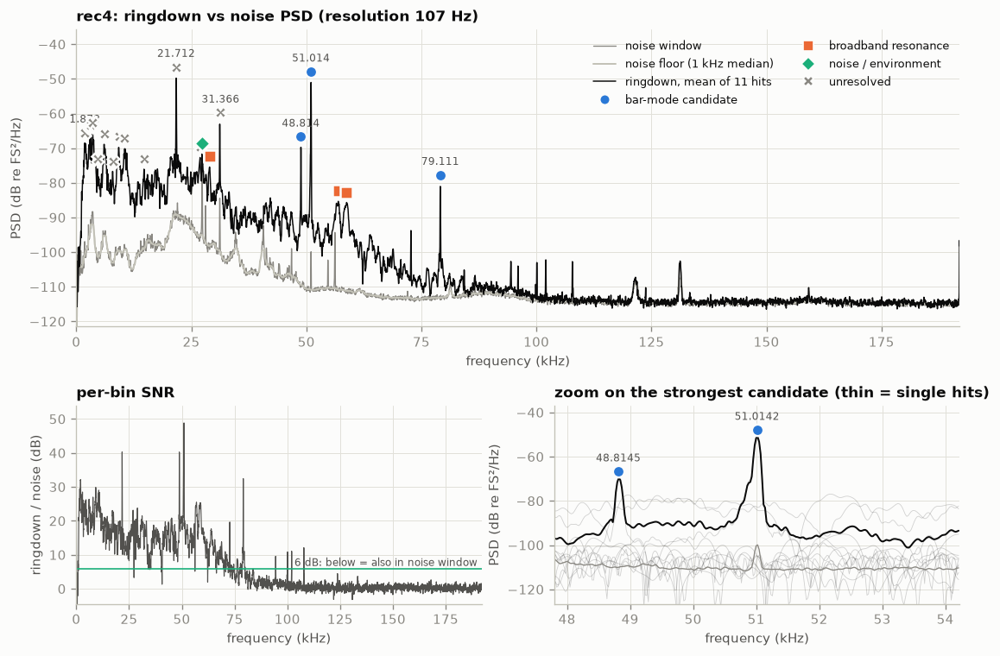
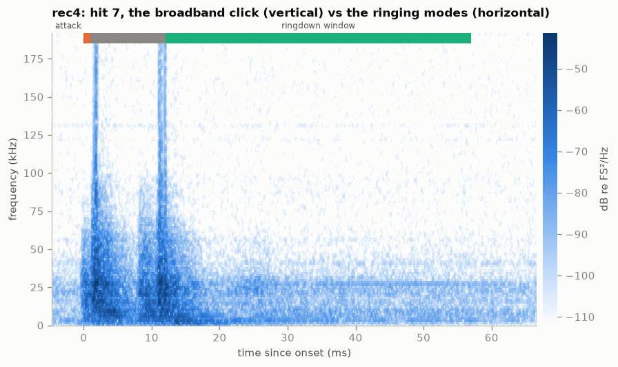
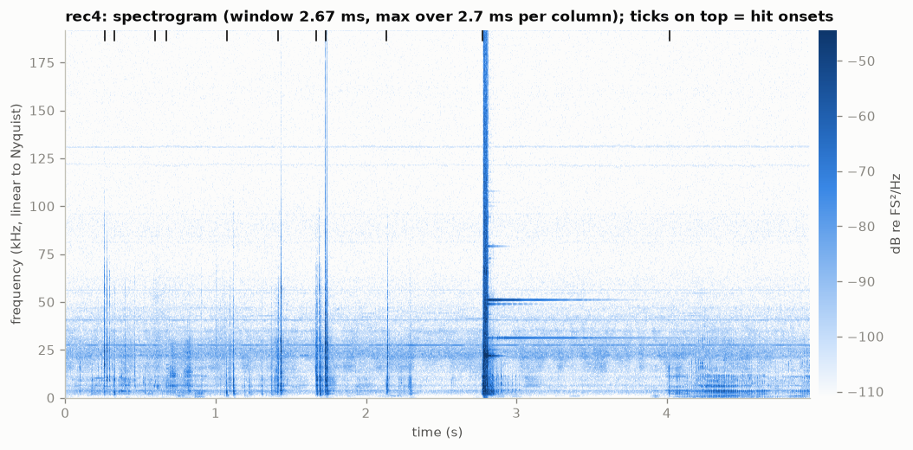
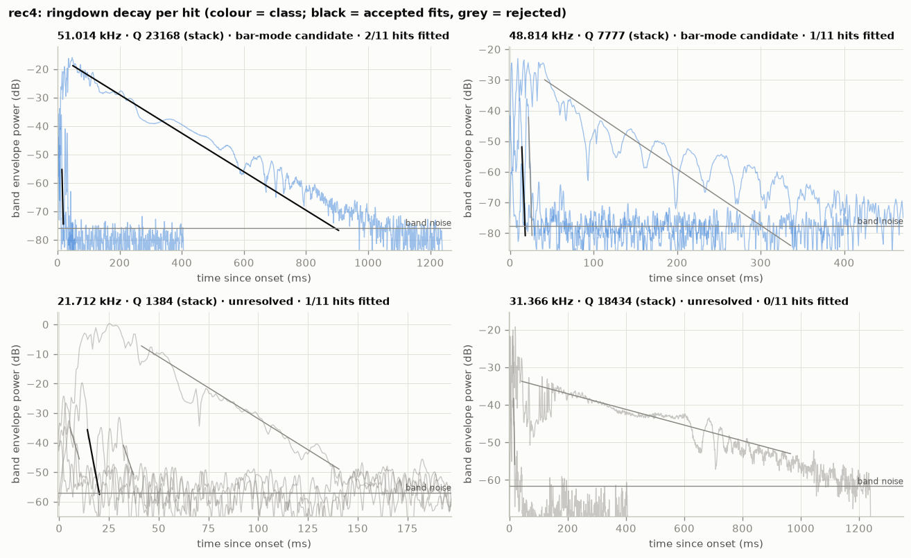
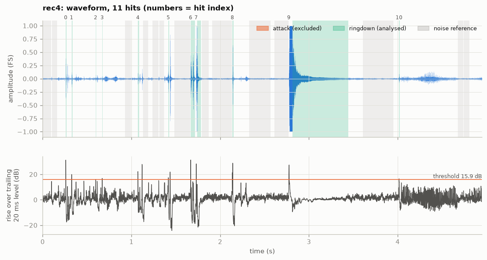

# rec4: bar ringing analysis (2026-10-09)

`data/raw/rec4.wav` · sha256 `9bc262d20101` · 384 kHz, 16-bit, 1 ch,
4.95 s · barlab 0.1.0 · data: [`result.json`](../rec4/result.json)

## Verdict

Ringing frequency: **51 014.2 ± 103.00 Hz** (spread over 3 hits; standard error 74.8 Hz),
Q ≈ 23 200 (stack; per-hit 310 and 20 600). This is the strongest candidate and the "~50 kHz" line
expected in this file. It starts at the strike at 2.774 s, rings for about 0.9 s, and stands 60.0 dB
above the noise floor.
Two weaker candidates: **48 814.5 ± 109.00 Hz** (3 hits; standard error 78.6 Hz), Q ≈ 7780
(stack), and **79 111.0 ± 29.70 Hz** (3 hits; standard error 21.5 Hz), Q ≈ 7890 (stack).

## Recording quality

- **Sample rate / format:** 384000 Hz (Nyquist 192000 Hz), PCM_16, 1 channel (analysed: 0),
  4.95 s. Device: PYG Bat_Detector_USB_384kHz via BatGizmo 3.1.2 (manual trigger, 0.5 s
  pretrigger), recorded 2026-10-09 16:13:44+02:00.
- **Warnings:**
  - `WARNING CLIPPING`: 961 samples (5.06e-04 of the file) reach full scale.
  - `WARNING CLIPPING_RINGDOWN`: 2 of 11 hits clip after the attack: hit 7 at 1.729 s (11.1 ms
    trimmed) and the main strike, hit 9 at 2.774 s (38.2 ms trimmed). So the first ~38 ms of the
    strongest ringdown are lost.
  - `INFO RESOLUTION_COARSE`: the median ringdown is 9.3 ms, which gives 107 Hz PSD resolution.
- **Hits:** barlab detects 11, but only one is a full strike: hit 9 (onset 2.774 s, ringdown
  628.5 ms).
  - Hits 6 and 7 (1.667 and 1.729 s, ringdowns 48.0 and 44.9 ms) look like an earlier, weaker
    double contact.
  - The other 8 are short transients (5-12 ms ringdowns): handling or rattle.

  Clipping is trimmed, with no hit excluded. The noise reference is 1.765 s, with no fallback.
- **Spectral resolution:** 107.1 Hz (target ≤ 50 Hz, missed because most "hits" are short
  transients). Frequencies come from per-hit phase fits, which are much finer than the PSD grid.
- **Ultrasonic content:** strongest excess above 20 kHz: 48.8 dB.

## Detected peaks

| # | f (Hz) | ± σ hits (Hz) | Q | τ (ms) | SNR (dB) | above floor (dB) | hits fitted | class | nearest theory |
|---|---|---|---|---|---|---|---|---|---|
| 0 | 1 872.6 | 93.20 | 280 (stack) | 47.6 | 29.1 | 32.5 | 1/11 | unresolved | — |
| 1 | 2 946.0 | 45.00 | 923 (stack) | 99.7 | 28.5 | 27.7 | 1/11 | unresolved | — |
| 2 | 3 160.0 | — | — | — | 25.7 | 25.7 | 0/0 | unresolved | — |
| 3 | 3 529.3 | 104.00 | 1660 (stack) | 150.0 | 23.0 | 26.3 | 0/11 | unresolved | — |
| 4 | 4 616.7 | — | — | — | 26.3 | 25.3 | 0/0 | unresolved | — |
| 5 | 6 075.2 | 129.00 | 907 (stack) | 47.5 | 26.4 | 26.3 | 0/11 | unresolved | — |
| 6 | 7 920.6 | 315.00 | 805 (stack) | 32.4 | 27.0 | 26.4 | 0/11 | unresolved | — |
| 7 | 9 308.7 | 199.00 | 1220 ± 7.94 (stack) | 41.6 | 29.6 | 30.0 | 2/11 | unresolved | — |
| 8 | 10 443.2 | 272.00 | 1280 (stack) | 39.1 | 28.1 | 29.1 | 0/11 | unresolved | — |
| 9 | 14 721.6 | — | — | — | 20.9 | 23.0 | 0/0 | unresolved | — |
| 10 | 21 712.0 | 141.00 | 1380 (stack) | 20.3 | 40.3 | 39.6 | 1/11 | unresolved | — |
| 11 | 26 898.6 | — | — | — | 23.2 | 22.6 | 0/0 | unresolved | — |
| 12 | 27 345.8 | — | — | — | 3.3 | 23.4 | 0/0 | noise_or_environment | — |
| 13 | 28 970.3 | — | — | — | 23.8 | 22.8 | 0/0 | broadband_resonance | — |
| 14 | 31 366.1 | 258.00 | 18400 (stack) | 187.0 | 21.4 | 37.2 | 0/11 | unresolved | — |
| 15 | 48 814.5 | 109.00 | 7780 (stack) | 50.7 | 40.3 | 39.7 | 1/11 | bar_mode_candidate | L unknown (long. n=1 needs L=51.5 mm) |
| 16 | 51 014.2 | 103.00 | 23200 ± 15000 (stack) | 145.0 | 48.9 | 60.0 | 2/11 | bar_mode_candidate | L unknown (long. n=1 needs L=49.2 mm) |
| 17 | 56 940.7 | — | — | — | 25.5 | 25.5 | 0/0 | broadband_resonance | — |
| 18 | 58 754.8 | — | — | — | 25.3 | 25.5 | 0/0 | broadband_resonance | — |
| 19 | 79 111.0 | 29.70 | 7890 (stack) | 31.7 | 32.4 | 32.4 | 0/11 | bar_mode_candidate | L unknown (long. n=1 needs L=31.4 mm) |

- "± σ hits" is the spread of the per-hit frequencies. "(stack)" means the Q comes from the
  hit-averaged envelope, because fewer than 3 hits gave a clean decay fit.
- Classes: `bar_mode_candidate`, `broadband_resonance` (low Q or wide), `noise_or_environment`
  (also present without hits), `unresolved` (see the reasons in result.json).

## Interpretation

- **Measured:**
  - **51 014.2 Hz**, from per-hit phase fits:
    - hit 7: 51 001.4 Hz (Q 310, r² 0.948);
    - hit 9: 51 014.2 Hz (Q 20 600, r² 0.919);
    - hit 6: 51 186.4 Hz (r² 0.013), a poor fit that inflates the ±103 Hz spread.

    Stacked τ 145 ms, Q 23 200 ± 15 000; SNR 48.9 dB; 60.0 dB above the floor. In `decay.png` the
    main strike falls from about −18 dB to the band noise in about 0.9 s.
  - **48 814.5 Hz:** τ 50.7 ms, with a strongly modulated (beating) envelope.
  - **79 111.0 Hz:** τ 31.7 ms.
  - **31 366.1 Hz** (τ 187 ms) and **21 712.0 Hz** ring as well, but their per-hit frequencies
    scatter by more than 1 % (1.16 % and 1.23 %), so they stay `unresolved`.
- **Inferred:**
  - **51.0 kHz** is a mode of the struck bar, and it is the "~50 kHz" signal. It starts at the
    strike, decays exponentially with a metal-like Q (≈ 2×10⁴), and is by far the strongest line
    above 20 kHz. With L unknown, the hypotheses need these lengths:
    - longitudinal n = 1: L = 49.20 mm;
    - flexural n = 2: L = 49.94 mm;
    - flexural n = 1: L = 30.72 mm;
    - torsional n = 1: L = 30.38 mm.

    (From `barlab theory --d 16mm --implied-from 51014.2`.)
  - **48.8 kHz** shows up in rec5 too (48 774.3 Hz, Δ 40.2 Hz, 0.4 σ). It is therefore probably
    shared by both strikes (the striker, the frame or the other bar) rather than specific to this
    bar. It must not be used to tell the two bars apart.
  - The hit-7 Q of 310 against 20 600 at hit 9 suggests the earlier contact was damped, for
    example by the striker staying in contact.
  - The 27 345.8 Hz line is an environment line; rec5 has it at 27 344.5 Hz too.
  - 28.97, 56.94 and 58.75 kHz are low-Q resonances.
- **Caveats:**
  - There is a single full strike. The "consistent over ≥ 2 hits" test rests on hit 7 (a weak,
    damped contact) and hit 9.
  - Q comes from the stacked envelope and is scattered.
  - The first ~38 ms of the main ringdown are clipped and removed.
  - The bar length is unknown, so there is no theory match.

## Comparison with previous recordings

| this f (Hz) | other recording | recorded | other f (Hz) | Δf = this − other (Hz) | Δf (ppm) | significance (Δf in σ) | Q this/other |
|---|---|---|---|---|---|---|---|
| 48 814.5 | rec5 | 2026-10-09 16:13:09+02:00 | 48 774.3 | 40.20 | 824 | 0.4 | 1.55 |

The only earlier raw recording in the index is rec5 (rec1-3 are still pending). Only the shared
48.8 kHz line matches. The 51.0 kHz line has no candidate match in rec5. rec5 does show a weak,
unfitted 51 013.9 Hz peak (18.3 dB SNR), probably this bar ringing weakly when the other one is
struck.

## Recommendations for the next recording session

- **Strike softer or lower the gain:** the main strike clipped, which cost its first 38 ms; the
  strongest hits reach full scale.
- **Record ≥ 5 clean strikes of this bar per file, ≥ 1 s apart:** 51 kHz rings for about 0.9 s.
  Per-hit consistency and a per-hit Q (instead of the stack) then become measurable.
- **Keep hands off the mechanism between strikes:** 8 of the 11 detected "hits" are handling
  transients, which dilute the PSD and shorten the ringdown windows.
- **Measure the bar length** (±0.1 mm) and note which button/bar was struck in
  `data/meta/rec4.toml`.
  - About 49.2 mm (or 49.9 mm) would point to longitudinal n = 1 (or flexural n = 2).
  - About 30.4-30.7 mm would point to torsional n = 1 or flexural n = 1.

## Figures

