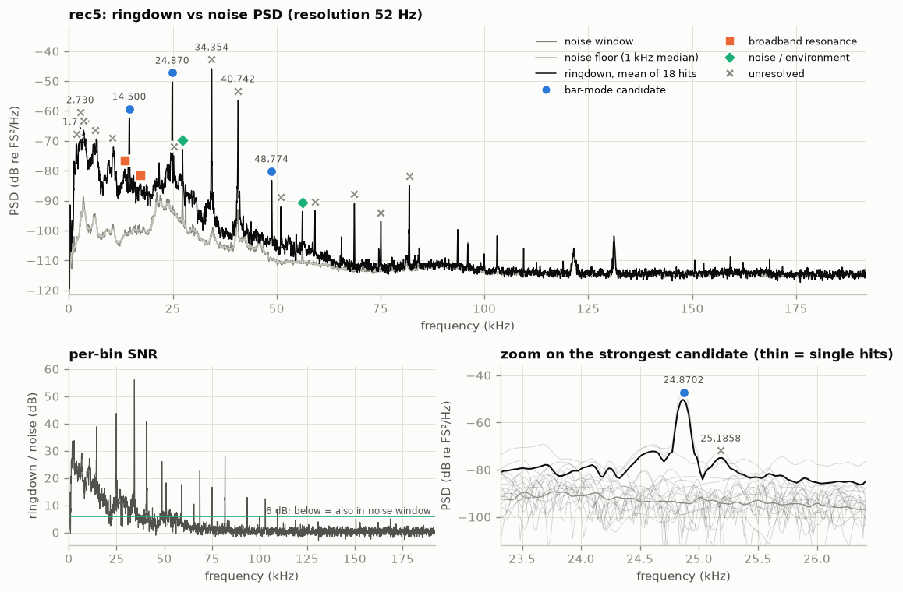
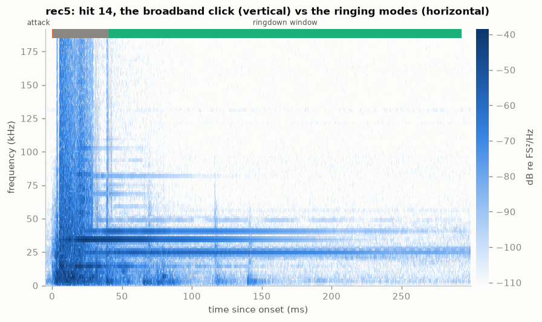
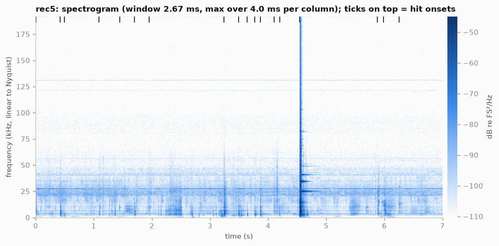
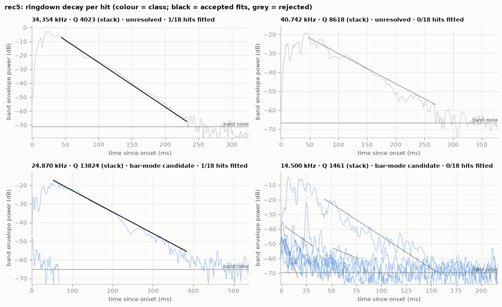
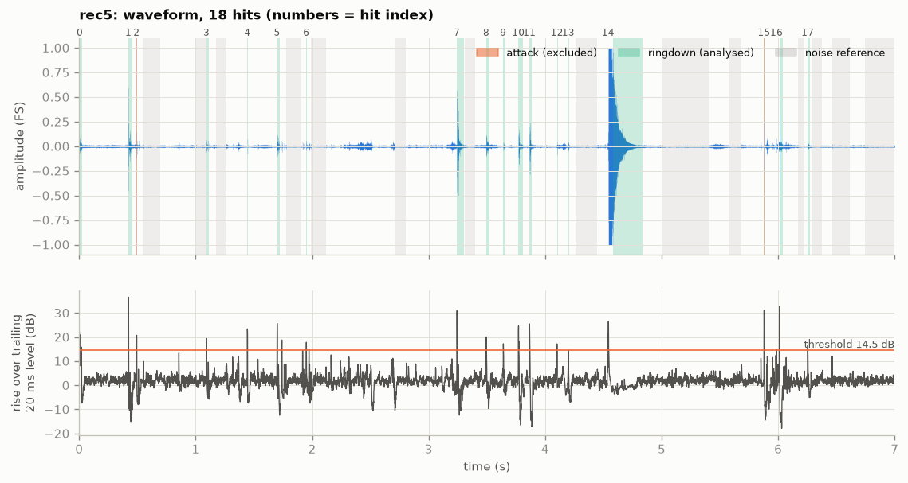

# rec5: bar ringing analysis (2026-10-09)

`data/raw/rec5.wav` · sha256 `9b8705ee692d` · 384 kHz, 16-bit, 1 ch,
7.0 s · barlab 0.1.0 · data: [`result.json`](../rec5/result.json)

## Verdict

Ringing frequency (barlab's strongest candidate): **24 870.2 ± 8.30 Hz** (spread over 2 hits;
standard error 7.36 Hz), Q ≈ 13 800 (stack).
Other candidates: **14 499.9 ± 53.90 Hz** (7 hits; standard error 25.5 Hz), Q ≈ 1460 (stack), and
**48 774.3 ± 73.80 Hz** (2 hits; standard error 65.4 Hz), Q ≈ 5010 (stack).

The expected "~40 kHz" line is there: **40 741.9 Hz**, Q ≈ 8620 (stack), SNR 39.4 dB. It starts at
the main strike (4.540 s) and decays with τ 67.3 ms. barlab leaves it `unresolved` because only
that one strike gives a frequency estimate, so consistency across hits cannot be tested. The
stronger **34 354.2 Hz** line (SNR 56.0 dB) is `unresolved` for the same reason.

## Recording quality

- **Sample rate / format:** 384000 Hz (Nyquist 192000 Hz), PCM_16, 1 channel (analysed: 0),
  7.0 s. Device: PYG Bat_Detector_USB_384kHz via BatGizmo 3.1.2 (manual trigger, 0.5 s
  pretrigger), recorded 2026-10-09 16:13:09+02:00.
- **Warnings:**
  - `WARNING CLIPPING`: 652 samples (2.43e-04 of the file) reach full scale.
  - `WARNING CLIPPING_RINGDOWN`: 2 of 18 hits clip after the attack: the main strike, hit 14 at
    4.540 s (39.6 ms trimmed), and hit 16 at 5.986 s (24.8 ms trimmed).
  - `INFO RESOLUTION_COARSE`: the median ringdown is 19.3 ms, which gives 52 Hz PSD resolution.
- **Hits:** barlab detects 18, but only one is a full strike: hit 14 (onset 4.540 s, ringdown
  252.4 ms; `hit_zoom.png` shows the 24.9, 34.4 and 40.7 kHz lines ringing after a ~40 ms clipped
  attack).
  - Hit 1 (0.422 s, ringdown 33.3 ms) is a weaker contact that also excites 24.9 kHz.
  - The other 16 are short transients (5-57 ms): handling or rattle.

  Clipping is trimmed, with no hit excluded. The noise reference is 2.0 s, with no fallback.
- **Spectral resolution:** 51.7 Hz (target ≤ 50 Hz). Frequencies come from per-hit phase fits,
  which are much finer than the PSD grid.
- **Ultrasonic content:** strongest excess above 20 kHz: 55.1 dB.

## Detected peaks

| # | f (Hz) | ± σ hits (Hz) | Q | τ (ms) | SNR (dB) | above floor (dB) | hits fitted | class | nearest theory |
|---|---|---|---|---|---|---|---|---|---|
| 0 | 1 777.6 | 84.90 | 413 (stack) | 74.0 | 33.5 | 33.1 | 0/18 | unresolved | — |
| 1 | 2 730.2 | 68.20 | 1280 ± 3.77 (stack) | 150.0 | 33.8 | 34.0 | 2/18 | unresolved | — |
| 2 | 3 504.9 | 105.00 | 415 (stack) | 37.7 | 22.6 | 27.0 | 0/18 | unresolved | — |
| 3 | 6 231.2 | 235.00 | 861 (stack) | 44.0 | 28.3 | 28.3 | 0/18 | unresolved | — |
| 4 | 10 538.5 | 252.00 | 928 (stack) | 28.0 | 27.2 | 27.5 | 1/18 | unresolved | — |
| 5 | 13 444.1 | — | — | — | 20.5 | 21.8 | 0/0 | broadband_resonance | — |
| 6 | 14 499.9 | 53.90 | 1460 (stack) | 32.1 | 38.9 | 38.7 | 0/18 | bar_mode_candidate | L unknown (long. n=1 needs L=174.2 mm) |
| 7 | 17 273.4 | — | — | — | 16.2 | 15.7 | 0/0 | broadband_resonance | — |
| 8 | 24 870.2 | 8.30 | 13800 (stack) | 177.0 | 43.8 | 43.2 | 1/18 | bar_mode_candidate | L unknown (long. n=1 needs L=101.5 mm) |
| 9 | 25 185.8 | — | — | — | 19.3 | 19.0 | 0/0 | unresolved | — |
| 10 | 27 344.5 | 2.31 | — | — | 2.6 | 23.9 | 0/18 | noise_or_environment | — |
| 11 | 34 354.2 | — | 4020 (stack) | 37.3 | 56.0 | 55.6 | 1/18 | unresolved | — |
| 12 | 40 741.9 | — | 8620 (stack) | 67.3 | 39.4 | 43.9 | 0/18 | unresolved | — |
| 13 | 48 774.3 | 73.80 | 5010 (stack) | 32.7 | 26.1 | 26.3 | 0/18 | bar_mode_candidate | L unknown (long. n=1 needs L=51.5 mm) |
| 14 | 51 013.9 | — | — | — | 18.3 | 18.9 | 0/0 | unresolved | — |
| 15 | 56 202.1 | — | — | — | -0.0 | 16.9 | 0/0 | noise_or_environment | — |
| 16 | 59 220.0 | — | — | — | 17.7 | 17.9 | 0/0 | unresolved | — |
| 17 | 68 709.9 | — | — | — | 22.7 | 22.5 | 0/0 | unresolved | — |
| 18 | 75 095.1 | — | — | — | 16.7 | 16.4 | 0/0 | unresolved | — |
| 19 | 81 917.0 | — | 6970 (stack) | 27.1 | 28.2 | 27.7 | 1/18 | unresolved | — |

- "± σ hits" is the spread of the per-hit frequencies. "(stack)" means the Q comes from the
  hit-averaged envelope.
- `unresolved` lines with "—" in the spread column have a frequency estimate from only one hit
  (reason: "only 1 hit(s) with a frequency estimate: consistency not testable").

## Interpretation

- **Measured:**
  - **24 870.2 Hz:** per-hit 24 876.1 Hz (hit 1, r² 0.054) and 24 864.4 Hz (hit 14, Q 5880,
    r² 0.946); stacked τ 177 ms.
  - **Main strike, hit 14 only:**
    - **34 354.2 Hz:** Q 2930 per hit, Q 4020 stacked, τ 37.3 ms, SNR 56.0 dB.
    - **40 741.9 Hz:** Q 6990 per hit (r² 0.828), Q 8620 stacked, τ 67.3 ms, SNR 39.4 dB, 43.9 dB
      above the floor. In `decay.png` it rings about 45 dB above the band noise for about 270 ms.
  - **48 774.3 Hz:** τ 32.7 ms.
  - **14 499.9 Hz:** Q 1460, with the per-hit envelopes scattered.
- **Inferred:**
  - **40.74 kHz behaves like a bar mode.** It starts at the strike, decays exponentially and has
    a metal-like Q (≈ 7-9 × 10³), and the noise window does not have it (SNR 39.4 dB). It is
    therefore not the steady 40.5 kHz environment line seen in rec1-3.
  - **It is the "~40 kHz" signal, but not the strongest line of this strike:** 34.35 kHz is
    stronger (SNR 56.0 against 39.4 dB). Whether 34.35 and 40.74 kHz are two modes of one bar, or
    two bars ringing together, cannot be told from one strike without L.
  - **Implied lengths** (from `barlab theory --d 16mm --implied-from …`):

    | Line | longitudinal n = 1 | flexural n = 1 | flexural n = 2 | torsional n = 1 |
    |---|---|---|---|---|
    | 40 741.9 Hz | 61.76 mm | 35.60 mm | 58.27 mm | 38.04 mm |
    | 34 354.2 Hz | 73.34 mm | 39.66 mm | — | 45.11 mm |
  - **24.87 kHz** (barlab's headline) is a long-ringing low mode excited by both contacts. It is
    barlab's primary candidate only because it is the strongest line that appears in ≥ 2 hits.
  - **48.77 kHz** matches rec4's 48.81 kHz (0.4 σ): probably shared by both strikes, not specific
    to either bar.
  - **51 013.9 Hz** (18.3 dB, not fitted) matches rec4's 51 014.2 Hz: the 51 kHz bar ringing
    weakly, probably by sympathetic coupling.
  - 27 344.5 and 56 202.1 Hz are environment lines.
- **Caveats:**
  - A single full strike: 40.74 and 34.35 kHz each rest on one ringdown, so they have no spread
    and no class.
  - The first ~40 ms of that ringdown are clipped and removed.
  - Q comes from the stacked envelope.
  - The bar length is unknown.

## Comparison with previous recordings

| this f (Hz) | other recording | recorded | other f (Hz) | Δf = this − other (Hz) | Δf (ppm) | significance (Δf in σ) | Q this/other |
|---|---|---|---|---|---|---|---|
| 48 774.3 | rec4 | 2026-10-09 16:13:44+02:00 | 48 814.5 | -40.20 | -824 | 0.4 | 0.64 |

Only the shared 48.8 kHz line matches rec4, which was recorded right after this file (rec1-3 are
still pending). The 40.74 kHz line does not appear in rec4.

## Recommendations for the next recording session

- **Record ≥ 5 clean strikes of this bar per file, ≥ 0.5 s apart.** 40.74 and 34.35 kHz then get
  per-hit spreads and a class instead of `unresolved`. With 5 strikes they should become
  `bar_mode_candidate` if they are real.
- **Strike softer or lower the gain:** the main strike clipped for about 40 ms.
- **Keep hands off the mechanism between strikes:** 16 of the 18 detected "hits" are handling
  transients.
- **Strike each bar in its own file** and note which button was pressed in `data/meta/rec5.toml`,
  with the measured bar length.
  - About 61.8 mm would make 40.74 kHz the longitudinal n = 1 mode.
  - About 73.3 mm would make 34.35 kHz the longitudinal n = 1 mode.

## Figures

